<!--
  Panels in assets/ are generated by tools/build.py (python tools/build.py).
  The activity panel and contribution snake are rebuilt daily by
  .github/workflows/profile.yml and published to the `output` branch.
-->

  
  
  
  

  <a href="https://github.com/shashwatmaran/ForensicaLite"><b>GitHub repo ↗</b></a> &nbsp;·&nbsp;
  <a href="https://shashwatmaran.github.io/ForensicaLite/"><b>Live report app ↗</b></a>

<b>How it works</b>

 

- Opens Windows volumes at the sector level (`\\.\X:`), bypassing OS file APIs and locks, and parses the NTFS boot sector, `$MFT`, `$Bitmap` and USN change journal by hand, with no third-party dependencies.
- The MFT parser handles update-sequence fixups, signed-delta data runs, fragmented `$MFT` extents and `$ATTRIBUTE_LIST` records. A 1 MiB chunk cache cuts physical reads to one per 1,024 records.
- Recovers resident deleted files byte for byte, and grades how recoverable non-resident ones are by checking `$Bitmap` for reallocated clusters.
- Flags timestomping (`$STANDARD_INFORMATION` vs `$FILE_NAME`, plus zeroed sub-second precision), hidden Alternate Data Streams and orphaned records, and rebuilds rename, move and delete history from the USN journal.
- A versioned JSON contract sits between analyzer and UI. Its JSON Schema is generated from TypeScript types and checked in CI against real analyzer output.
- An offline React report app (triage, timeline, hex viewer, IndexedDB case storage, HTML/CSV export) means evidence never leaves the examiner's machine.
- Ships as a tkinter GUI and a CLI packaged as standalone Windows executables. Tests run against a synthetic NTFS image built byte by byte, so they need no real drive and no admin rights.

  <a href="https://github.com/shashwatmaran/FinTrack"><b>Web repo ↗</b></a> &nbsp;·&nbsp;
  <a href="https://github.com/shashwatmaran/FinTrack-mobile-app"><b>Android repo ↗</b></a>

<b>How it works</b>

 

- A greedy debt-simplification algorithm with integer-paise maths, so totals never drift from rounding.
- Escrow-style settlements: a logged payment only moves balances once the recipient confirms it. The server enforces this with conditional updates, so a double-submit can't bring back a declined payment.
- All data access goes through one `DataStore` interface with MongoDB and in-memory implementations, held together by a shared contract test suite that runs against a real in-process `mongod`.
- Hardened Auth.js: bcrypt, password reset that stores only token hashes and logs out every session, enumeration-safe responses, open-redirect-safe `?next=`, Redis-backed rate limiting with a per-process fallback, and CSP headers.
- A daily recurring-expense job handles month-end dates, catches up on missed runs and claims each rule atomically, so two runs can't double-charge a group.
- Containerised and deployed on AWS ECS Fargate behind an Application Load Balancer, with Terraform, Secrets Manager, least-privilege IAM, CloudWatch alarms and a GitHub Actions pipeline.
- Native Android client in Kotlin and Jetpack Compose: Bearer-token sessions encrypted with AES-GCM in the Android Keystore, Google sign-in via Credential Manager with server-side ID-token verification, cached bootstrap data, deep-linked invites, and a neobrutalist design system rebuilt from scratch in Compose.

<b>Repo coming soon</b>

<b>How it works</b>

 

- Kids arrange printed ArUco cards on a desk, read by a Python/OpenCV camera pipeline, or drag matching Blockly blocks. Both compile to one JSON AST that runs on a deterministic Go executor.
- 25 levels across sequencing, loops, nested loops, if/else, while and composition. Each one is run against the real executor to confirm it can be solved.
- An on-device pet tutor runs Qwen3 0.6B or 1.7B through llama.cpp, choosing the size from available RAM. It only rewrites pre-verified, human-written hints and never judges code, so nothing leaves the building.
- One cross-compiled Go binary serves the React frontend and JSON API, and owns a portable SQLite save file on each student's drive.
- An optional classroom hub on the Pi collects progress for a teacher dashboard and restores lost drives. Sync is HMAC-authenticated, and restores can only raise saved progress.
- Drives move between unmanaged machines, so a checksum manifest detects tampering at launch and the server listens only on loopback by default.

<picture>
  <source media="(prefers-color-scheme: dark)" srcset="https://raw.githubusercontent.com/shashwatmaran/shashwatmaran/output/snake-dark.svg">
  <source media="(prefers-color-scheme: light)" srcset="https://raw.githubusercontent.com/shashwatmaran/shashwatmaran/output/snake-light.svg">
  
</picture>

  
  
  
  

